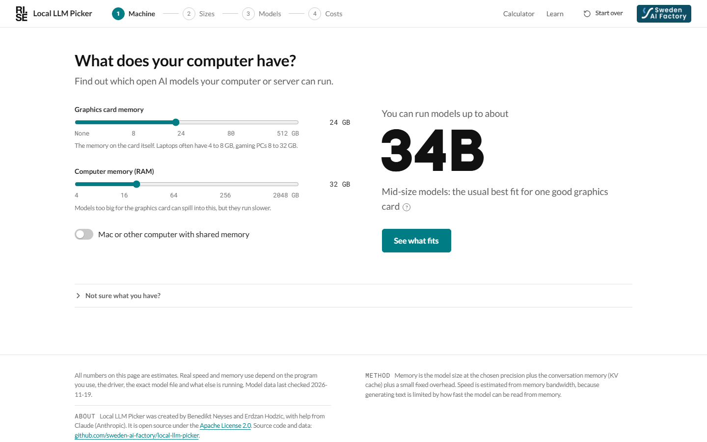
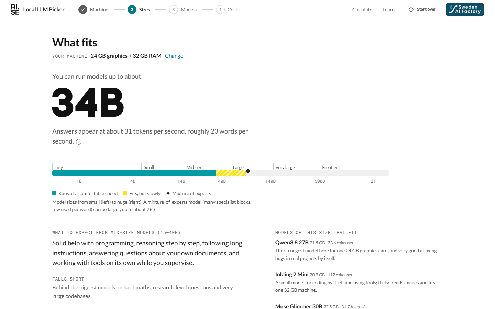
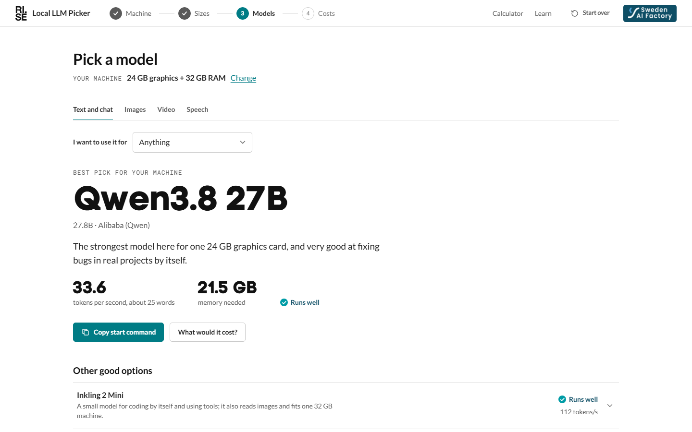
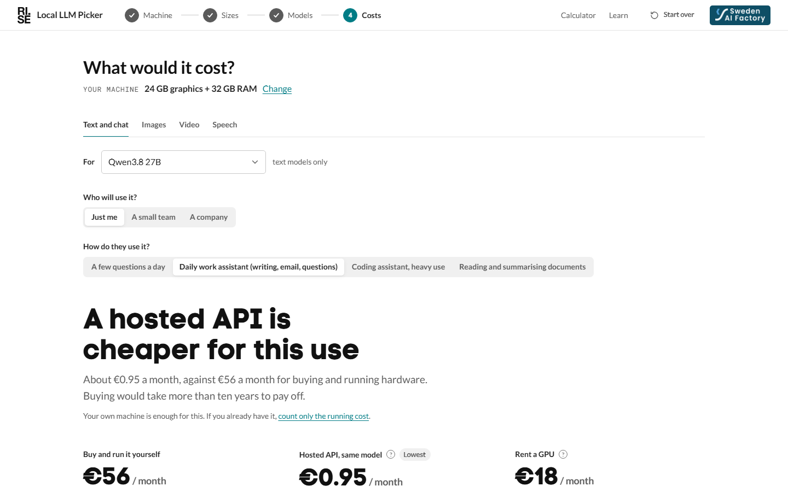

# Local LLM Picker

Find out which open AI models your own computer or server can run, how fast they will be, and what it costs compared with the cloud.

Local LLM Picker is a single HTML file. It runs in any modern browser, works offline, and sends nothing anywhere. You tell it how much memory your machine has, and it shows what size of model fits, which named models are worth trying, and whether buying hardware, renting a GPU or paying a hosted service is cheaper for your use. It is written for complete beginners, and it is meant to be useful for small and large organisations that want to run AI themselves.



## Download

To use the tool, download `Local-LLM-Picker.html` from the [latest release](https://github.com/sweden-ai-factory/local-llm-picker/releases/latest) and open it in a browser. It is one file with Sweden AI Factory and RISE branding. There is nothing to install and no server to start.

The repository holds the source. If you want to change the tool or build an unbranded copy, see [Build from source](#build-from-source).

## What it does

The tool is a four-step path. Each step can also be opened on its own, and the Calculator and Learn pages sit beside it.

1. **Machine.** Two sliders for graphics card memory and computer memory, a switch for Macs and other shared-memory computers, and a list of 320 or so graphics cards, Macs, mini PCs, servers and processors to pick from. "Detect this computer" reads the graphics card name from the browser.
2. **Sizes.** The largest model size your machine runs comfortably, what a model of that size can and cannot do, and a chart from 0.5 billion to 3 trillion parameters.
3. **Models.** A best pick for your machine and a short list of alternatives, with speed, memory, licence and a command to start it. About 50 text and vision models, and 34 image, video, speech and transcription models.
4. **Costs.** For the model you choose and the way you use it: the cost of buying and running hardware, of a hosted pay-per-token API for the same model, of renting a GPU by the hour, and a paid assistant for reference. Prices can be shown in EUR, SEK or USD. It works for text, images, video and speech.

Beside the path:

- **Calculator.** Move model size, precision, context length and number of users, and watch memory and speed change.
- **Learn.** A plain-language guide with thirteen chapters on memory, quantisation, speed, mixture of experts, tools such as llama.cpp, Ollama and vLLM, file formats, images and speech, running a team service, what it costs, and licences. The chapters include interactive demos.
- **Start over.** A button in the header that clears every setting.

| | |
|---|---|
|  |  |
|  | |

## How accurate is it

All numbers are estimates, usually within about 30 percent.

- **Memory** is the model size at the chosen precision, plus the memory for the conversation (the KV cache), plus a small fixed overhead.
- **Speed** comes from memory bandwidth, because producing text is limited by how fast the model can be read from memory. The constants are fitted to llama.cpp measurements for 78 pieces of hardware (see `docs/QA-REPORT.md`).
- **Image, video and speech speed** is scaled from a measured run on another graphics card. It can be off by a factor of two.
- **Prices** are a snapshot from 23 November 2026. Graphics card and memory prices are unusually volatile in 2026, and provider prices change often.

Model facts, hardware figures and prices were collected from the vendors' and providers' own pages and from public benchmark reports. Where something could not be verified, the data says so. Each data file has a notes file with sources and uncertainties.

## Repository layout

```
src/                      page, scripts and styles
  theme/open.css, open.js the open theme of the default build
  engine.js               memory and speed estimation
  app.js                  steps, calculator, hardware dialog
  media.js                images, video and speech
  costs.js                the cost comparison
  learn.html / .js / .css the Learn page
  img/                    partner logo
data/                     models, hardware, runtimes, prices, with notes
build.mjs                 builds the single file from src/ and data/
docs/                     screenshots and the test report
```

The finished, branded file is not part of the source tree. It is attached to each release.

## Updating the data

The numbers live in `data/`:

| File | Content |
|---|---|
| `models-llm.json` | text and vision models, with a short description of what each is good and weaker at |
| `models-media.json` | image, video, speech and transcription models |
| `hardware.json` | graphics cards, Macs, mini PCs, servers, processors, with memory, bandwidth and benchmarks |
| `hardware-overrides.json` | per-chip speed corrections fitted to measurements |
| `overrides.json` | adjustments for models released already compressed |
| `pricing.json` | hosted API prices, GPU rental, hardware street prices, electricity, exchange rates, usage profiles |
| `runtimes.json` | the tools in the Learn page |
| `*-notes.md` | sources and uncertainties for each file |

Edit a file, then rebuild.

## Build from source

You need Node.js 18 or newer, nothing else.

```
node build.mjs
```

This writes `dist/Local-LLM-Picker-plain.html`: the whole tool in one offline file, with the open theme from `src/theme/` (system fonts, no font files, no network) and the Sweden AI Factory logo, without RISE branding. The build stops if the file would load anything from the internet, embed a font or contain a personal file path.

The file in the releases is the branded version. It uses the RISE design system, which is not part of this repository, so only people who have that design system can build it.

## Credits

Local LLM Picker was created by Benedikt Neyses and Erdzan Hodzic, with help from Claude (Anthropic).

## Licence

The code and data files in this repository are released under the [Apache License 2.0](LICENSE). See [`NOTICE`](NOTICE) for the parts that are not covered by it: the Sweden AI Factory and RISE logos, the RISE design system (fonts, styles and scripts) that is built into the branded release file, and the names of the products and companies mentioned, which belong to their owners. The open theme in `src/theme/` is part of this repository and released under the Apache License 2.0; the default build contains no RISE material.

The tool gives estimates for planning. Check the licence of every model and the current price before you rely on them.
